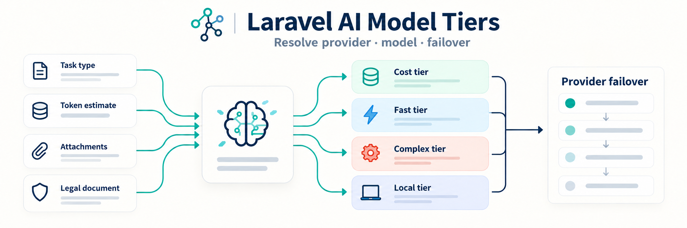

<p align="center"></p>

# Laravel AI Model Tiers

[](https://github.com/eloquage/laravel-ai-model-tiers/actions/workflows/run-tests.yml)

Resolve a provider, model, timeout, and failover chain for a built-in or custom AI task. Your application passes the resolved profile to its AI client.

## Requirements

- PHP 8.4 or newer
- Laravel 11, 12, or 13

The Laravel AI SDK is optional and is not installed by this package. Install it separately if you use the integration examples from that SDK.

## Install

```bash
composer require eloquage/laravel-ai-model-tiers
```

Laravel discovers the service provider automatically. To edit the package settings, publish its config:

```bash
php artisan vendor:publish --tag=laravel-ai-model-tiers-config
```

## Resolve a profile

Pass a tier and task. Use `null` as the tier to use `default_tier` from the package config. With `auto`, built-in task defaults and context signals select the tier.

```php
use Eloquage\LaravelAiModelTiers\Enums\AiTask;
use Eloquage\LaravelAiModelTiers\ModelTierResolver;

$text = 'Translate this legal document.';

$profile = app(ModelTierResolver::class)->resolve(
    tier: 'auto',
    task: AiTask::Translation,
    context: [
        'token_estimate' => (int) (strlen($text) / 4),
        'legal_document' => true,
    ],
);

$profile->provider;          // e.g. deepseek
$profile->model;             // e.g. deepseek-chat
$profile->timeout;           // seconds
$profile->failoverOrSingle(); // provider/model chain, or the single provider
```

For embeddings, the resolver uses `embedding_tier`:

```php
$profile = app(ModelTierResolver::class)->forEmbeddings();
```

## Tiers and tasks

Built-in tiers are `auto`, `cost`, `fast`, `complex`, and `local`. Built-in tasks are `translation`, `ocr_vision`, `embedding`, `summarization`, `correlation`, and `structured_extraction`.

Register custom tasks in `config/ai-model-tiers.php`:

```php
'custom_tasks' => [
    'commit_message' => 'local',
],
```

Pass the custom task as a string: `$resolver->resolve('auto', 'commit_message')`. Custom tasks use their configured tier; without one they resolve to `cost`.

## Configuration

The config file defines `default_tier`, `embedding_tier`, `task_defaults`, `custom_tasks`, provider/model `profiles`, per-tier `failover` chains, and the token thresholds under `auto`. Provider names must match the provider keys configured by your AI client.

## Checks

```bash
composer test
composer test-coverage
composer analyse
composer format
```

## License

MIT. See [LICENSE.md](LICENSE.md).
